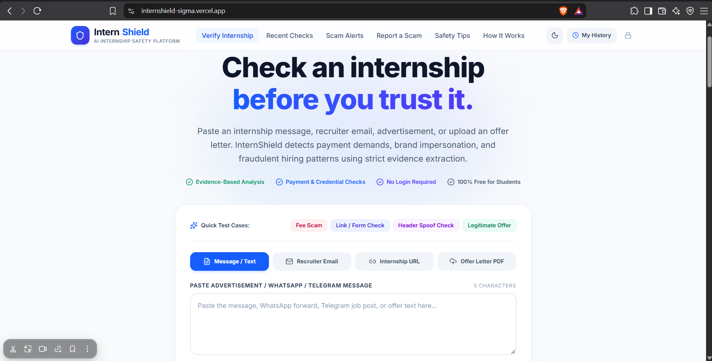

<div align="center">

# 🛡️ InternShield

### AI Internship Scam Verification Platform

**Check an internship before you trust it.**

InternShield helps students and freshers verify whether an internship offer, recruiter email, WhatsApp/Telegram message, or offer letter is genuine, suspicious, or a scam — _before_ they apply, share documents, or pay any money.

[](https://internshield-sigma.vercel.app)
[](./LICENSE)


<br/>



</div>

---

## ✨ Overview

Internship scams targeting students are rampant — fake offer letters, upfront "registration fees", laptop "security deposits", and recruiters using personal Gmail addresses while impersonating real companies. InternShield extracts hard evidence from whatever a student receives and returns a transparent **0–100 risk score** with a plain-English explanation, so the decision isn't a gut feeling.

- 🔍 **Evidence-based** — flags are tied to concrete signals, not vibes
- 💸 **Payment & credential checks** — zero-tolerance scan for fee/OTP/Aadhaar/PAN demands
- 🔓 **No login required** — history stays in your browser
- 🎓 **Free for students**

---

## 🧪 Key Features

### Multi-input verification
Paste advertisement text, WhatsApp/Telegram forwards, or recruiter email headers; enter a listing URL or Google Form link; check a company name + recruiter email for domain authenticity; or upload an offer-letter PDF/screenshot (PNG/JPG, up to 5 MB). One-click demo samples let you test instantly.

### The 4-Pillar Verification Protocol
| Pillar | What it catches |
| --- | --- |
| **Company Check** | Real corporate registration vs. brand impersonation |
| **Internship Check** | Role plausibility, "direct selection" claims, impossible stipends |
| **Recruiter Check** | Personal webmail (`@gmail.com`, `@yahoo.com`) posing as corporate hiring |
| **Payment & Credential Risk** | Upfront fees, "security deposits", OTP/Aadhaar/PAN requests |

### Multi-tier AI & forensic engine
- **Primary AI:** Google Gemini (`gemini-2.0-flash`)
- **Fallback AI:** NVIDIA Nemotron
- **Deterministic fallback:** local forensic rules that work **100% out of the box** — no API key required

### Transparent report
A visual risk meter (Low / Caution / High / Unable to verify), plain-English reasoning, specific recommendations, a printable view, and a shareable report link.

### Privacy & community
- Anonymous check history in client-side `localStorage` with per-item and "Clear All" controls
- Community scam-alert feed with automated spam/abuse moderation
- Protected moderator dashboard at `/admin` to review and approve reports
- Student education pages: safety tips, how it works, FAQ, privacy, terms, disclaimer

---

## 🧱 Tech Stack

| Layer | Technology |
| --- | --- |
| Framework | Next.js 16 (App Router) |
| UI | React 19, Tailwind CSS 4, lucide-react |
| Language | TypeScript 5 |
| AI | Google Gemini API, NVIDIA Nemotron API, local rules engine |
| Data | Supabase (Postgres) — optional; built-in local store runs by default |
| Hosting | Vercel |

---

## 🚀 Quick Start

### Prerequisites
- Node.js **18.18+**, 20+, or 22+
- npm

### Install & run
```bash
git clone https://github.com/legend0x01/internshield.git
cd internshield
npm install
npm run dev
```
Open **http://localhost:3000**.

### Production build
```bash
npm run build
npm start
```

> 💡 The app is **fully functional with no API keys** — the local rule engine and seeded store power every feature out of the box. Add keys only when you want live AI analysis or a cloud database.

---

## ⚙️ Environment Variables

Create a `.env.local` file in the project root:

```env
# Primary AI — Google Gemini (free tier): https://aistudio.google.com/
GOOGLE_API_KEY=your_gemini_api_key_here
GOOGLE_AI_MODEL=gemini-2.0-flash

# Fallback AI — NVIDIA Nemotron (optional)
NVIDIA_API_KEY=your_nvidia_api_key_here
NVIDIA_API_BASE_URL=https://integrate.api.nvidia.com/v1
NVIDIA_AI_MODEL=meta/llama-3.1-70b-instruct

# Supabase (optional; local store runs without it)
SUPABASE_URL=https://your-project.supabase.co
SUPABASE_SERVICE_ROLE_KEY=your_service_role_key
NEXT_PUBLIC_SUPABASE_URL=https://your-project.supabase.co
NEXT_PUBLIC_SUPABASE_ANON_KEY=your_anon_key

# Admin moderation passcode — set your OWN strong secret, do not reuse a default
ADMIN_SECRET=change_me_to_a_long_random_string
```

> ⚠️ **Security:** never commit `.env.local`, and always set `ADMIN_SECRET` to a long, random value. The `/admin` dashboard is only as safe as this secret.

---

## 🗄️ Database Setup (optional, Supabase Postgres)

1. Create a free project at [supabase.com](https://supabase.com).
2. Open the **SQL Editor** in the dashboard.
3. Run the script at [`supabase/schema.sql`](./supabase/schema.sql).
4. Copy your Project URL and Service Role Key into `.env.local`.

---

## 📁 Project Structure

```
internshield/
├─ src/
│  ├─ app/              # Next.js App Router pages
│  │  ├─ page.tsx       # Home / verification checker
│  │  ├─ admin/         # Moderator dashboard
│  │  ├─ alerts/        # Community scam-alert feed
│  │  ├─ report-scam/   # Confidential report form
│  │  ├─ safety-tips/ · how-it-works/ · faq/
│  │  ├─ privacy/ · terms/ · disclaimer/ · recent/
│  │  └─ api/           # Route handlers (check, alerts, admin, report-scam)
│  ├─ components/       # Reusable UI
│  ├─ lib/              # ai, rules, store, document/email/link readers
│  └─ types/            # Shared TypeScript types
├─ supabase/            # schema.sql
├─ public/              # static assets
└─ docs/                # screenshot & docs assets
```

---

## 🧭 College Project Demo Script

1. **Home (`/`)** — show the hero, trust indicators, and the 4-pillar idea.
2. **Scam detection** — load the **Fee Scam** sample → *Analyze* → point out the **Very High Risk (88/100)** score, red payment-pillar alert, and "DO NOT PAY ANY FEE" advice.
3. **Legitimate offer** — load the **Legitimate** sample → show the **lower risk (12/100)** with green ticks and honest "verify independently" guidance.
4. **My History** — open the navbar history to show local, login-free storage.
5. **Alerts & reporting (`/alerts`, `/report-scam`)** — approved alerts with the mandated disclaimer, plus the confidential report form.
6. **Moderator portal (`/admin`)** — log in with your `ADMIN_SECRET`, review pending reports, and approve one for the public feed.

---

## 🤝 Contributing

Issues and pull requests are welcome. For larger changes, open an issue first to discuss the direction.

---

## 📄 License

Released under the [MIT License](./LICENSE) © 2026 legend0x01.

---

## ⚖️ Disclaimer

InternShield provides **AI-assisted risk indicators**, not legal advice or official government verification. Always confirm an opportunity through the company's official website or careers page before acting on it.
